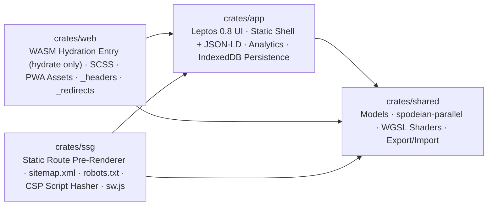

# Architecture Guide · `efficient-leptos-edge-template`

This template is purpose-built for **pure serverless edge deployments** where every route arrives as pre-rendered static HTML on the first byte and hydrates in-place with WebAssembly (`wasm32-unknown-unknown`), without maintaining a backend server, Tauri shell, or native desktop runner.

---

## 1. Crate Boundaries (4-Crate Edge Workspace)

| Crate | Cargo Features | Responsibility |
|---|---|---|
| `crates/shared` | `std` | Pure Rust domain entities (`Item`, `ItemCollection`, `AppState`, `UndoStack`), `ParametricPreviewConfig`, `spodeian-parallel` sweeps, WGSL compute kernel source (`PARAMETRIC_HARMONIC_WGSL_SHADER`), and JSON/CSV/BSON/SVG/HTML/`#state=` interchange. |
| `crates/app` | `ssr`, `hydrate` | Reactive UI components (`Navbar`, `ItemList`, `AnalyticsPage`, `AboutPage`, `CommandPaletteModal`, `ExportModal`, `ImportModal`, `TelemetryModal`, `StorageModal`), static document shell (`shell.rs`), and `spodeian-cache` browser storage. |
| `crates/web` | `hydrate` | Minimal WebAssembly cdylib exporting `hydrate()` + static public files (`sw.js`, `manifest.json`, `_headers`, `_redirects`, self-hosted Atkinson Hyperlegible fonts). |
| `crates/ssg` | `ssr` | Native CLI executable run post-build to render `/`, `/analytics`, `/about`, and `/404`, strip SSR nonces, emit `sitemap.xml` + `robots.txt`, stamp `sw.js`, and write SHA-256 CSP hashes into `_headers`. |

---

## 2. Static SSR + WASM Hydration Pipeline

1. **Pre-render (`crates/ssg`)**: `leptos_axum::generate_route_list_with_ssg` renders every `SsrMode::Static` route to semantic HTML. Crawlers and no-JS visitors receive full content immediately, complete with OpenGraph tags, `<link rel="canonical">`, and Schema.org `WebApplication` JSON-LD (`EDGE_JSON_LD_SCRIPT`).
2. **Pre-Paint Theme & Dyslexia Sync (`THEME_PREPAINT_SCRIPT`)**: An inline script in `<head>` reads `serverless_leptos_theme` and `serverless_leptos_dyslexia` from `localStorage` before first paint so hydrated HTML never flashes the wrong colors or font spacing.
3. **Deterministic Hydration Handshake (`crates/app/src/client.rs`)**: Both SSR and the browser's first hydration frame render default `AppState` so DOM structures match byte-for-byte. Immediately afterward inside `Effect::new`, asynchronous IndexedDB state, theme preferences, and URL hash snapshots hydrate smoothly.
4. **Zero-`unsafe-inline` Strict CSP (`_headers` + `spodeian-web-utils::pwa`)**: Every inline `<script>` body (including `THEME_PREPAINT_SCRIPT` and `EDGE_JSON_LD_SCRIPT`) has its Base64 SHA-256 digest computed at build time by `finalise_static_site` and injected into `_headers` (`'sha256-...'`). No `unsafe-inline` JS or `unsafe-eval` is required (only `'wasm-unsafe-eval'` for WebAssembly compilation).

---

## 3. Compute & Graphics Readiness (`rayon`, `wasm32`, `wgpu`)

- **Cross-Target Parallelism (`spodeian-parallel`)**:
  - During static site generation (`ssg`) and host unit tests, `ParametricPreviewConfig::sample_points` and `batch_harmonic_sweep` execute across Rayon's work-stealing thread pool (`par_iter`).
  - Inside the `wasm32` browser bundle (`crates/web` compiled with `+simd128,+bulk-memory,+nontrapping-fptoint` via `.cargo/config.toml`), `spodeian-parallel` compiles with zero synchronization overhead down to LLVM auto-vectorized sequential loops.
- **WebGPU Compute Path (`PARAMETRIC_HARMONIC_WGSL_SHADER` + `sml-kernel`)**:
  - Developers adding GPU-accelerated simulations can feed `PARAMETRIC_HARMONIC_WGSL_SHADER` directly into `sml_kernel::WgpuContext::new_async().await` (gated by `spodeian_web_utils::has_webgpu_support()`) and validate outputs against `ParametricPreviewConfig::evaluate_harmonic_wgsl_cpu_reference`.

---

## 4. Browser Storage & Quota Protection

- Preferences and item indexes route through `spodeian_cache::PreferentialStore` (selecting `localStorage` vs. `IndexedDB`).
- Items pass through `spodeian_cache::AsyncTieredStore` with a bounded RAM working set (`MEMORY_WORKING_SET_LIMIT = 100`), automatically spilling overflow records into IndexedDB without unbounded memory growth.
- Failed writes are never silenced: diagnostics propagate cleanly into a visible `"Not saved."` banner and one-click `.bson` backup trigger.
