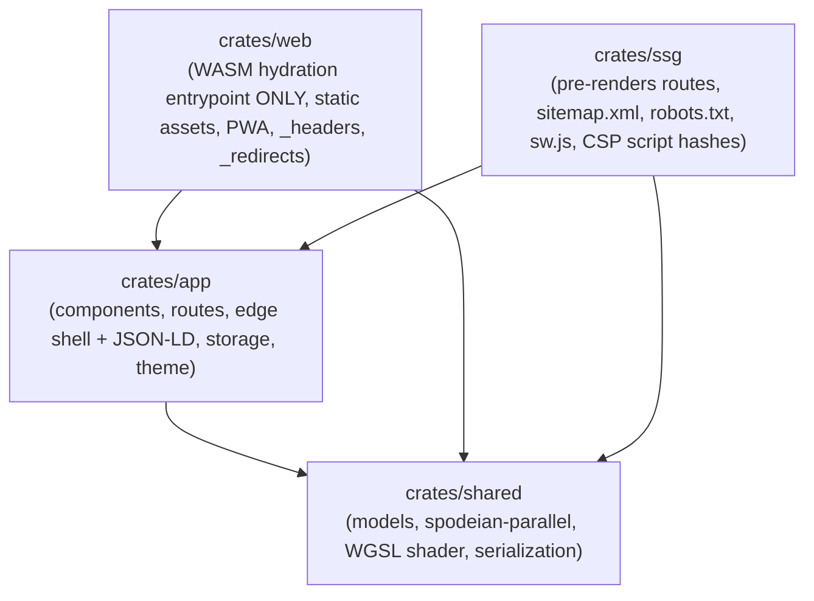

# Pure Serverless Edge Leptos Template

[](https://github.com/Spodeian/efficient-leptos-edge-template/actions/workflows/ci.yml)
[](https://github.com/Spodeian/efficient-leptos-edge-template/actions/workflows/static.yml)
[](LICENSE.md)
[](https://www.rust-lang.org)
[](https://leptos.dev)
[](https://pages.cloudflare.com)
[](https://pages.cloudflare.com)

A modular Rust & [Leptos 0.8](https://leptos.dev) template engineered **exclusively for zero-backend serverless edge deployments** (Cloudflare Pages, GitHub Pages, Netlify, AWS S3/CloudFront). Every route arrives as pre-rendered static HTML on the first byte and hydrates in-place via WebAssembly (`hydrate`), with **zero** desktop, Tauri, or CSR shell dependencies.

The example app delivers a responsive top bar, routed Dashboard (`/`), Analytics (`/analytics`), and About (`/about`) pages, Undo/Redo (`Ctrl+Z`/`Ctrl+Y`), searchable Command Palette (`Ctrl+K`), SVG/HTML/`#state=` interchange, `spodeian-parallel` sweeps, a bundled WGSL WebGPU compute shader, offline PWA support, and persistent `spodeian-cache` storage. See [`ARCHITECTURE.md`](ARCHITECTURE.md) for deep architectural conventions.

---

## Choosing Across the Three Spodeian Templates

| Template | Best For | Architecture | Compute, GPU & Native Target |
|---|---|---|---|
| **`efficient-leptos-edge-template`** *(this repo)* | Pure zero-backend websites, SEO landing pages, calculators, PWAs | 4 crates (`shared`, `app`, `web`, `ssg`) — zero desktop deps | Static SSR + WASM `hydrate` only, Schema.org JSON-LD, `sitemap.xml`, `_redirects`, Rayon SSR / SIMD128 WASM, WGSL kernel ready |
| **`efficient-leptos-template`** | Apps shipping **both** a pre-rendered website and a native desktop/mobile executable | 5 crates (`shared`, `app`, `web`, `ssg`, `desktop`) | Static SSR + WASM `hydrate` + Tauri v2 `csr` + native Rayon IPC commands + WGSL kernel ready |
| **`efficient-egui-template`** | Custom 2D/3D viewports, CAD/audio/science GUIs, single-binary desktop+web apps | 4 crates (`shared`, `app`, `desktop`, `web`) + `spodeian-ui` | `wgpu` (default) / `glow`, native `winit` + `mimalloc`, `spodeian-parallel` (Rayon/WASM), WGSL kernel ready |

---

## Using this Template

### Option A: `cargo-generate` (Recommended)
```bash
cargo install cargo-generate
cargo generate --git https://github.com/Spodeian/efficient-leptos-edge-template.git --name my-edge-site
cd my-edge-site
```
Interactive flags in [`cargo-generate.toml`](cargo-generate.toml) let you keep or omit PWA assets (`sw.js`, `manifest.json`) and Cloudflare Pages config (`wrangler.toml`, `_headers`, `_redirects`, `deploy.sh`).

### Option B: GitHub Template
1. Click **"Use this template"** > **"Create a new repository"** on GitHub.
2. Clone your new repository and follow [Customizing for Your App](#customizing-for-your-app).

---

## Architecture (4-Crate Edge Workspace)



- **`crates/shared`**: Domain models (`AppConfig`, `AppPage`, `AppState`, `UndoStack`, `ParametricPreviewConfig`, `EdgeComputeSummary`), `spodeian-parallel` Rayon/WASM sweeps, `PARAMETRIC_HARMONIC_WGSL_SHADER` (`@compute @workgroup_size(64)`), and JSON/CSV/compressed-BSON/SVG/HTML/`#state=` interchange.
- **`crates/app`**: Leptos UI routes (`/`, `/analytics`, `/about`, `/404`), `PageMeta` (OpenGraph, Twitter card, canonical), static SSR document shell (`shell.rs` with pre-paint theme/dyslexia sync, `<noscript>`, and `EDGE_JSON_LD_SCRIPT`), `CommandPaletteModal`, `UndoStack`, and `spodeian-cache` storage. Exactly two mutually exclusive modes exist: `ssr` (pre-renderer) and `hydrate` (browser WASM).
- **`crates/web`**: Minimal WebAssembly library crate exposing `hydrate()`, plus SCSS and `public/` assets (`sw.js`, `manifest.json`, icons, self-hosted Atkinson Hyperlegible fonts, `_headers`, `_redirects`).
- **`crates/ssg`**: Native binary invoked post-build (`scripts/build-web.sh`) that renders all routes, strips nonces, generates `sitemap.xml` and `robots.txt`, stamps `sw.js`, and computes SHA-256 CSP inline-script hashes in `_headers`.

Hydration safety rule: server pre-rendered HTML and the browser's first hydration frame render default state deterministically; saved theme, dyslexia spacing, and IndexedDB items hydrate inside `Effect::new` (`client_ready()`).

---

## Key Features

- **Zero-Backend Static SSR + WASM Hydration**: Content-hashed `/pkg/` bundles, byte-reproducible HTML, `_redirects` 404 routing, and automatic `sitemap.xml` + `robots.txt` (`crates/ssg`).
- **SEO & Strict CSP Without `unsafe-inline` Scripts**: Schema.org `WebApplication` JSON-LD (`EDGE_JSON_LD_SCRIPT`), OpenGraph, Twitter card, canonical links, self-hosted fonts, `<noscript>` guidance, pre-paint theme/dyslexia script, and automated SHA-256 CSP script hashing in `_headers`.
- **Cross-Target Compute (`spodeian-parallel` & WebGPU WGSL)**: `ParametricPreviewConfig::sample_points` and `batch_harmonic_sweep` execute across Rayon threads during SSR builds/tests and compile cleanly to WASM `+simd128` sequential execution in browsers; `PARAMETRIC_HARMONIC_WGSL_SHADER` + `evaluate_harmonic_wgsl_cpu_reference` provide a ready-to-dispatch WebGPU shader path.
- **Analytics & Parametric Explorer (`/analytics`)**: SSR-safe reactive priority SVG bars, harmonic sliders, live `EdgeComputeSummary` metrics, collapsible WGSL kernel viewer, and one-click `.svg` + printable `.html` downloads.
- **Productivity & Safe Interchange**: Searchable `CommandPaletteModal` (`Ctrl+K`), 64-step `UndoStack<ItemCollection>` (`Ctrl+Z`/`Ctrl+Y`), `"Clear Completed"`, JSON/CSV/Compressed-BSON/SVG/HTML/`#state=` URL hash export & import, and confirmed async `write_clipboard_text`.
- **Durable Client Storage (`spodeian-cache`)**: `PreferentialStore` (`localStorage` vs. `IndexedDB`) + working-set bounded `AsyncTieredStore` with visible failure banners and one-click `.bson` backup recovery.
- **Accessibility**: Skip link, `aria-current` links, inline SVG icons, modal `trap_tab_within_element` focus traps, dyslexia typography toggle, recoverable `<ErrorBoundary>` view, and automated WCAG AA contrast checks.

### Comparison vs. Official Leptos Starters

| Capability | `efficient-leptos-edge-template` | Official `start-axum` | Official `start-trunk` |
|---|---|---|---|
| **Release Architecture** | Pure Static SSR + WASM Hydration (`crates/ssg` + `hydrate` only) | Requires live Axum Rust server runtime | Client-side CSR only (empty shell HTML) |
| **Edge SEO & Security** | Auto `sitemap.xml`, `robots.txt`, JSON-LD, `_redirects`, SHA-256 CSP hashing, immutable `/pkg/*` caching | Manual setup | None built in |
| **Compute & Visualization** | `spodeian-parallel` (Rayon SSR / SIMD128 WASM), WGSL shader + `/analytics` SVG charts | Manual setup | None built in |
| **Productivity & Persistence** | `CommandPaletteModal` (`Ctrl+K`), `UndoStack`, `spodeian-cache` (IndexedDB + working-set spillover) | None built in | None built in |
| **Interchange & PWA** | JSON, RFC 4180 CSV, Compressed BSON, SVG, Printable HTML, `#state=` links, build-stamped `sw.js` | None built in | Manual setup |

---

## Build Requirements

- **Rust** (managed by [`rust-toolchain.toml`](rust-toolchain.toml)): includes `wasm32-unknown-unknown`.
- **Web Build Tooling**: `scripts/build-web.sh` installs pinned `cargo-leptos` (`0.3.4`) and `wasm-bindgen-cli` matching `Cargo.lock`. Ensure **Sass** and **Binaryen (`wasm-opt`)** are available on `PATH` in locked-down environments.
- **Node.js** (see [`.node-version`](.node-version)) for local Wrangler edge previews (`npx wrangler pages dev target/site`).

---

## Development Quickstart

### Build Pre-Rendered Edge Release
```bash
bash scripts/build-web.sh            # outputs target/site
npx wrangler pages dev target/site   # local edge preview
```

### Run Test Suite
```bash
# Native host & SSR tests (no desktop dependencies)
cargo test --workspace --features app/ssr

# Headless browser WASM hydration tests (Chrome/Firefox + wasm-bindgen-cli matching Cargo.lock)
cargo test -p web --features hydrate --tests --target wasm32-unknown-unknown
```

### Lint & Documentation Checks (Each Mode Explicitly Verified)
```bash
cargo fmt --all -- --check && leptosfmt --check crates
cargo clippy -p shared -p app -p ssg --all-targets --features app/ssr -- -D warnings
cargo clippy -p app -p web --target wasm32-unknown-unknown --features app/hydrate,web/hydrate -- -D warnings
RUSTDOCFLAGS="-D warnings" cargo doc --no-deps -p shared -p app --features app/ssr
cargo run -p shared --example state_interchange_and_report
cargo check -p shared --benches
```

---

## Deployment

### Cloudflare Pages
- **Build command**: `bash deploy.sh`
- **Build output directory**: `target/site`
- Includes [`wrangler.toml`](wrangler.toml), [`crates/web/public/_headers`](crates/web/public/_headers), and [`crates/web/public/_redirects`](crates/web/public/_redirects).

### GitHub Pages
- [`.github/workflows/static.yml`](.github/workflows/static.yml) runs `bash scripts/build-web.sh` and deploys `target/site` automatically on pushes to `main`.

---

## Customizing for Your App

1. Update workspace metadata (`name`, `version`, `repository`) in [`Cargo.toml`](Cargo.toml) and [`wrangler.toml`](wrangler.toml).
2. Replace `Item` / `ItemCollection` in [`crates/shared/src/models.rs`](crates/shared/src/models.rs) with your domain types and adjust `PARAMETRIC_HARMONIC_WGSL_SHADER` for custom client or edge compute visualizations.
3. Add routes in `AppPage` (`crates/shared/src/models.rs`) and [`crates/app/src/lib.rs`](crates/app/src/lib.rs) using `SsrMode::Static(StaticRoute::new())` and `PageMeta` — `crates/ssg` will pre-render them and include them in `sitemap.xml` automatically.
4. Customize Schema.org `EDGE_JSON_LD_SCRIPT` in [`crates/app/src/shell.rs`](crates/app/src/shell.rs) and the `storage` namespace in [`crates/app/src/storage.rs`](crates/app/src/storage.rs).

---

## Testing & Quality Assurance

| Test Suite | Location | Verified Host Count & Purpose |
|---|---|---|
| App unit tests | `crates/app/src/components/telemetry_viewer.rs` | `2` unit tests for telemetry uptime & relative age formatting |
| App integration & SSR tests | `crates/app/tests/app_tests.rs` | `18` tests covering state mutations, storage diagnostics, working-set spillover, SSR `<ErrorFallbackView>` / `<AboutPage>` / `<AnalyticsPage>` (incl. WGSL kernel), edge `shell()` (pre-paint dyslexia + JSON-LD + `<noscript>`), `UndoStack`, and WCAG AA contrast checks |
| Shared unit & property tests | `crates/shared/tests/shared_tests.rs` | `17` tests (including `proptest` suites for `u64` BSON bit-preservation, schema migration, RFC 4180 CSV round-trips, HTML escaping, `UndoStack`, SVG/HTML/`#state=` exports, theme cycles, and `spodeian-parallel` sweep / WGSL CPU parity) |
| SSG unit tests | `crates/ssg/src/main.rs` | `5` tests validating `spodeian_web_utils::pwa` CSP script hashing, precache URLs, nonce stripping, and `sitemap.xml` / `robots.txt` generation |
| Web native smoke test | `crates/web/tests/smoke_tests.rs` | `1` native smoke test (**`43` native workspace tests total**) |
| Web browser tests | `crates/web/tests/{routing,storage,wasm}_tests.rs` | Headless Chrome/Firefox DOM, routing, and IndexedDB persistence suites (`--target wasm32-unknown-unknown --features hydrate`) |
| Example & Benchmarks | `crates/shared/examples/state_interchange_and_report.rs`, `crates/shared/benches/serialization_benchmarks.rs` | Runnable interchange report example & Criterion benchmarks for 100-item JSON, CSV, and compressed BSON export |

CI also executes `scripts/build-web.sh` and verifies zero-JS SSR content across every generated page, JSON-LD presence, non-empty `sitemap.xml` / `robots.txt` / `_redirects`, and complete nonce removal.

---

## License

Licensed under the [PolyForm Noncommercial License 1.0.0](LICENSE.md). You may use,
change and share this software for any noncommercial purpose. For a
commercial license, contact [Spodeian](https://github.com/Spodeian). Earlier
releases keep the license they were published under.

Projects generated from this template inherit the PolyForm Noncommercial
License unless Spodeian grants otherwise.
